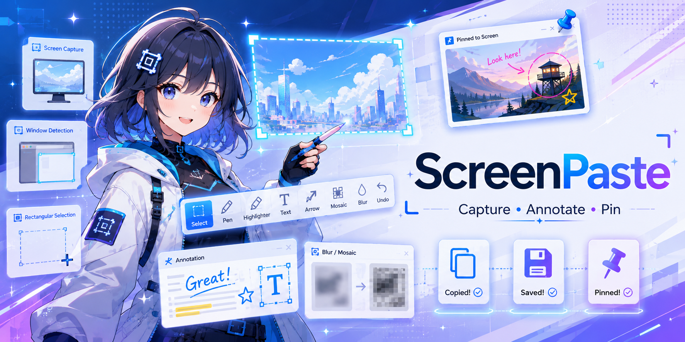
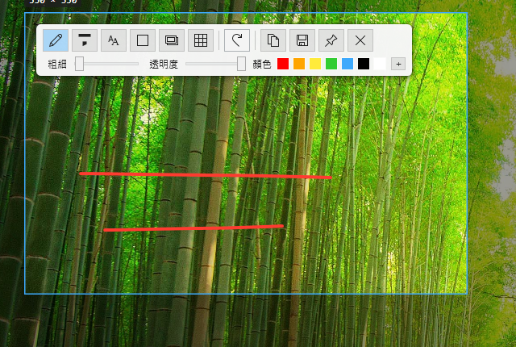

[繁體中文](README.md) | [English](README.en.md) | **日本語** | [한국어](README.ko.md) | [Français](README.fr.md) | [Deutsch](README.de.md) | [Español](README.es.md)

# ScreenPaste

軽量な Windows 用スクリーンショット・注釈・画面録画ツール。ワンキーでキャプチャ、すぐに注釈、画面にピン留め、任意の範囲を GIF / MP4 / WebP に録画できます。

## 機能

### キャプチャ
- 画面全体（マルチモニター対応）
- **ウィンドウ / UI 要素の自動検出**：ウィンドウやインターフェース要素（ボタン、パネル、Web ページのブロック）にマウスを合わせると自動で枠が表示され、クリックでキャプチャ。**マウスホイール**で検出レベルを切り替え（要素 ⇄ ウィンドウ）
- ドラッグで任意の範囲を選択。サイズ表示付き。**ピクセル拡大鏡**が常にカーソルに追従（範囲選択・編集の両モード）し、十字線・座標・ピクセル色を表示 — `C` でカラー値をコピー、`Shift` の単押しで HEX / RGB / HSV を切替
- **選択後も調整可能**：四隅と各辺中央のハンドルをドラッグしてサイズ変更。ツール未選択時は範囲内をドラッグして移動でき、既存の注釈は画面の内容に固定されたまま

### 注釈
キャプチャ後、カーソルの近くに**アイコンツールバー**が表示されます（ドラッグで移動可能、画面端を自動回避）：

- **マーカー** — 実線ストローク。太さ / 色 / 不透明度を調整可能
- **蛍光ペン** — 半透明の重ね塗り。太さ / 色 / 不透明度を調整可能
- **テキスト** — フォント / サイズ / 色 / スタイル（標準、太字、斜体、取り消し線）を選択可能。枠の外をクリックで確定
- **図形** — 四角形 / 角丸四角形 / 楕円。枠線または塗りつぶし、線の太さと色を調整可能
- **直線 / 矢印** — ドラッグで描画。両端それぞれに矢印の有無を切り替え可能。太さと色を調整でき、`Shift` で 45° 単位にスナップ
- **画像貼り付け** — PNG / JPEG / WebP を貼り付け。ドラッグで移動、ホイールで拡大縮小
- **ぼかし** — ガウスぼかし / モザイク。強さを調整可能。すべての注釈より上に描かれるため下にあるストロークや図形も隠せ、ドラッグで移動できます（移動先の内容を再サンプリングします）。種類（ガウス / モザイク）の既定値は設定で指定でき、ツールバーで切り替えると次回に引き継がれます
- **拡大表示** — 拡大したい範囲をドラッグで囲むと、その横に拡大ビューが配置されます：四角形 / 角丸 / 円、倍率（1.2〜10 倍）・枠線の太さと色・引き線・影・滑らか（オフでハードなピクセル格子）、拡大内容に他の注釈を含めるかを設定可能。拡大ビューと**元の範囲の枠はどちらもいつでもドラッグで移動できます** — 枠を動かせば拡大される内容が変わり、引き線も新しい位置を指し直します。拡大鏡を選択すると枠に**8 つのハンドルが出てサイズを変更**でき（拡大ビューも倍率に応じて追従）、ホイールで倍率を変更できます
- **直接選択 / 移動** — 配置済みの注釈にマウスを合わせて**そのままドラッグで移動**。`Delete` で削除。移動・削除とも元に戻せます
- **カラーピッカー** — Hex 入力、RGB、不透明度に対応（半透明色は市松模様の上でプレビュー）。カスタム色は次回以降も記憶され、右クリックで削除可能
- **元に戻す / やり直し** — ボタンとホットキーの両方に対応。すべてのスライダーに数値表示付き

### 出力
- クリップボードへコピー
- PNG / JPG として保存（名前を付けて保存、または既定フォルダーへクイック保存）
- **画面にピン留め**：画像が最前面に浮かびます。ドラッグで移動、ホイールでカーソル位置を中心に拡大縮小、右クリックでメニュー。ダブルクリック・`Esc`・`Ctrl+W` で閉じても `F3` で呼び戻せます（`Shift+Esc` は破棄）。複数ピン留め時は Esc でフォーカス中のものから閉じ、フォーカスがなければすべて閉じます。`F3` でクリップボードの内容もピン留めできます

### 範囲録画
- 専用のグローバルホットキー（既定 **F2**）：ドラッグで録画範囲を選択、または**ウィンドウをクリックで自動検出**（ホイールでウィンドウ／要素レベルを切り替え、キャプチャと同じ）して開始、もう一度押す（または停止ボタン）で終了
- 録画中は赤い枠で範囲を表示。タイマーと停止ボタン付きの小さなバーが表示されます
- 録画後に**エディター**が開きます：ループプレビュー、タイムラインのトリムハンドル（`Space` 再生、`←`/`→` コマ送り、`I`/`O` で開始/終了点を設定）、進捗バー付きエクスポート
- **録画中に赤い枠の縁をドラッグして録画範囲を移動可能** — 枠の内側は録画対象の操作がそのまま可能
- エディターにはキャプチャと同じ**注釈ツール**（テキスト / 図形 / 直線・矢印 / 画像 / ガウスぼかし / モザイク、オプション行付き。注釈は直接ドラッグ移動、`Delete` で削除）；`Ctrl+C` でクイックエクスポートしてファイルをクリップボードへ
- **GIF / MP4 / WebP** で書き出し（エディター内で切り替え可能）。設定でエディターをスキップして即保存も可能
- マウスカーソルの録画は任意、フレームレートは 10–30 fps
- **音声**：システム音（ループバック）／マイク／両方のミックスを設定で選択可能。音声は **MP4** のみ保存されます（GIF・WebP は無音）。使用可能な音声デバイスがない場合（リモートデスクトップで多い）は自動的に無音録画になります
- 同梱の `ffmpeg` でエンコード。追加インストール不要

### その他
- グローバルホットキー（**F1** キャプチャ、**Ctrl+F1** キャプチャしてコピー、**Shift+F1** カスタムキャプチャ、**F2** 録画、**F3** 貼り付け / 画像を復元、**Shift+F3** ピン留め画像を隠す / 表示、いずれもカスタマイズ可能）と**システムトレイ**アイコンから起動
- **多言語対応**：繁體中文 / English / 日本語 / 한국어 / Français / Deutsch / Español（既定はシステムに従う）
- **ライト / ダーク / システムに従う**テーマ。モダンな角丸 UI とダークタイトルバー
- 一元化された**設定ウィンドウ**：言語、ホットキー、テーマ、自動起動、保存フォルダー、注釈の既定値（ぼかしの種類）、録画形式 / フレームレート（ホットキー欄はキーを押すだけで設定可能。キャプチャ中とピン留め画像のキーもすべて割り当て直せます）
- **Windows 起動時の自動実行**（任意）
- **自動更新**：GitHub Releases 経由で新バージョンを確認（設定でオン/オフ、手動確認も可能）。ワンクリックでダウンロード＆インストール（進捗と速度を表示）

## インストール

[Releases](https://github.com/taida957789/ScreenPaste/releases) からダウンロード：

- **`ScreenPaste-<version>-setup.exe`** — インストーラー版（管理者権限不要、`%APPDATA%\ScreenPaste` にインストール、スタートメニューのショートカットとアンインストーラー付き）
- **`ScreenPaste-<version>-win-x64-portable.zip`** — ポータブル版（インストール不要）

どちらも自己完結型で、**.NET Runtime の別途インストールは不要**。範囲録画用の `ffmpeg` も同梱されています。

## クイックスタート

1. 起動後はシステムトレイに常駐。**F1**（またはトレイアイコンをダブルクリック）でキャプチャを開始。
2. ウィンドウや UI 要素にマウスを合わせて自動枠表示 → クリックでキャプチャ、またはドラッグで範囲選択。
3. ポップアップツールバーからツールを選び、パラメーターを調整して選択範囲に注釈。
4. **コピー / 保存 / ピン留め**で出力。`Esc` でキャプチャを終了（確認ダイアログあり、「今後は確認しない」も選択可）。

録画：**F2** を押してドラッグで範囲を選択すると録画開始。もう一度 **F2**（または停止ボタン）で終了し、エディターでプレビュー・トリムして GIF/MP4/WebP でエクスポート（設定で即保存に変更可能）。

## ホットキー一覧

ショートカットは Snipaste に同じ操作があればそれに合わせており、表には既定のキーを載せています。グローバルホットキーは 設定 →「ホットキー」で、キャプチャ中とピン留め画像のキーはすべて 設定 →「アプリ内ショートカット」→「キーをカスタマイズ…」で割り当て直せます（1 つの操作に 2 つまで。キーが重複すると警告）。固定なのはテキストボックス自体の編集キーと、ドラッグ中に押し続ける修飾キー（`Shift` など）だけです。

> **このバージョンでの変更点**
> - **ピン留め画像をダブルクリックすると閉じます**（初回は確認あり）。設定 →「ピン留め画像」で、サムネイル切替または何もしないに変更できます。
> - `Esc`／`Ctrl+W` で閉じたピン留め画像は**呼び戻せます**：前回の貼り付け以降クリップボードが変わっていなければ、`F3` で元の位置に戻ります。`Shift+Esc` は**完全に破棄**します。
> - ホイールによるピン留め画像のズームは**カーソル位置が中心**になりました（設定 →「ピン留め画像」で左上固定に戻せます）。
> - 拡大鏡のカラー形式（HEX → RGB → HSV）は **`Shift` の単押し**（単独で押して離す）で切り替わります。`Shift`＋ドラッグや `Shift`＋クリックでは切り替わりません。

### グローバル

| キー | 動作 |
|---|---|
| `F1` | キャプチャ開始（カスタマイズ可） |
| `Ctrl+F1` | キャプチャしてコピー：範囲を選ぶとすぐクリップボードへ（カスタマイズ可） |
| `Shift+F1` | カスタムキャプチャ：ダイアログで範囲と遅延を指定（カスタマイズ可） |
| `F2` | 範囲録画の開始 / 停止（カスタマイズ可） |
| `F3` | クリップボードの内容（画像、画像ファイル、カラー値、テキスト）をカーソル位置にピン留め。クリップボードが変わっていないときにもう一度押すと、最後に閉じた画像を呼び戻す（カスタマイズ可） |
| `Shift+F3` | すべてのピン留め画像を隠す / 表示（カスタマイズ可） |
| 既定は未割り当て | ピン留め画像のクリック透過（カーソル下の画像がクリックを通す）、キャプチャして固定、キャプチャしてコピー・固定、前回の範囲をもう一度コピー、画面全体をコピー、アクティブウィンドウをキャプチャ、カーソルのある画面をキャプチャ、遅延キャプチャ、キャプチャ履歴を消去：設定 →「ホットキー」／「その他のホットキー」で割り当て |
| トレイアイコン | ダブルクリックでキャプチャ開始。メニューにはカスタムキャプチャ、クリップボードから貼り付け、ピン留め画像を隠す／表示、「すべてのピン留め画像をクリック可能にする」のほか、設定を残したままキャプチャのホットキーをオフ／オンできる「キャプチャのホットキー（F1）」（ゲームに F1 を譲るときなどに）もあります |

### キャプチャ：範囲選択中

| キー | 動作 |
|---|---|
| クリック / ドラッグ | 強調表示中のウィンドウや UI 要素をキャプチャ / 任意の範囲を選択 |
| ホイール | 検出レベル切り替え（UI 要素 ⇄ ウィンドウ） |
| `Tab` | UI 要素検出とウィンドウ検出を切り替え |
| `Space` | 強調表示中の範囲を選択 |
| `Ctrl+A` | カーソルのある画面、もう一度押すと全画面を選択 |
| `Shift`＋ドラッグ | 正方形で選択 |
| ドラッグ中に `Space` を押し続ける | サイズを変えずに範囲を移動 |
| `W` `A` `S` `D` / 矢印キー | カーソルを 1 ピクセル移動（押し続けると加速）。ドラッグも追従 |
| `Alt` の単押し | 十字ガイド線の表示 / 非表示（状態を記憶） |
| `C` | 拡大鏡が指すピクセルのカラー値をコピー |
| `Shift` の単押し | カラー表示を HEX → RGB → HSV の順に切り替え |
| `R` / `Shift+R` | 以前のキャプチャの範囲を前 / 次へたどる |
| `,` / `.` | キャプチャ履歴を前 / 次へたどる（以前のキャプチャ。注釈は統合済み。メモリ内のみ） |
| `` ` `` または `!` | キャプチャ内のマウスカーソルの表示 / 非表示（状態を記憶） |
| `F5` | オーバーレイの下の画面を撮り直す |
| 右クリック | 選択中の範囲を破棄。選択中でなければキャプチャを終了 |
| `Esc` | キャプチャを終了 |

### キャプチャ：編集・注釈中

| キー | 動作 |
|---|---|
| ハンドルをドラッグ | 範囲のサイズ変更（`Ctrl`：中心基準、`Space` 押下中：移動） |
| 範囲内をドラッグ（ツール未選択） | 範囲を移動（`Shift`：一方向のみ） |
| 矢印キー | 範囲を 1 ピクセル移動。注釈を選択中ならその注釈を移動 |
| `Ctrl` / `Shift`＋矢印キー | その方向に範囲を拡大 / 縮小 |
| `Ctrl+A` | 範囲をカーソルのある画面に、もう一度押すと全画面に |
| `W` `A` `S` `D` | カーソルを 1 ピクセル移動（描画中も可） |
| `C` / `Shift` の単押し | 拡大鏡のカラー値をコピー / 形式を切り替え（範囲選択中と同じ） |
| `R` / `Shift+R`、`,` / `.`、`` ` `` / `!`、`F5` | 範囲選択中と同じ。注釈は画面の内容に付いたまま（`,` / `.` は先に確認） |
| `Space` | ツールバーの表示 / 非表示 |
| `Ctrl+1` … `Ctrl+9`、`Ctrl+0` | 図形、直線 / 矢印、マーカー、蛍光ペン、ぼかし / モザイク、テキスト、番号マーカー、拡大表示、消しゴム、画像を貼り付け |
| `T` / `B` / `M` / `E` | テキスト / マーカー / ぼかし / 消しゴム |
| `Ctrl+Tab` / `Ctrl+Shift+Tab` | 次 / 前のツール |
| `Tab` | ツールの種類を切り替え：四角 → 角丸 → 楕円、直線 ⇄ 矢印、ガウス ⇄ モザイク、拡大表示の形 |
| `1` / `2`、`[` / `]`、ホイール | 細く / 太く（テキストツールでは文字サイズ） |
| `Alt+C` | カーソル下の色を取得 |
| `+` / `-` | 番号マーカー：次の番号を増やす / 減らす |
| カラースウォッチ上でホイール | ツールの不透明度を調整 |
| 描画中に `Shift`＋ドラッグ | 図形・ぼかし・拡大表示の枠を正方形に、ペンの線を直線に、直線を 45° 単位に |
| クリック（直線ツール） | 折れ線を開始：クリックごとに点を追加。右クリック、`Esc`、`Enter`、ダブルクリックで終了 |
| 注釈をドラッグ | 注釈を移動（`Shift`：一方向のみ） |
| `Ctrl`＋注釈をドラッグ | コピーを引き出す |
| `Shift`＋ホイール | 選択中の四角 / 楕円を拡大縮小 |
| 選択中の拡大表示上でホイール | 倍率を変更 |
| `Delete` | 選択中の注釈を削除 |
| `Ctrl+Shift+C` / `Ctrl+Shift+V` | 選択中の注釈をコピー / そのコピーを貼り付け |
| `Ctrl+Z` / `Ctrl+Y` | 元に戻す / やり直し |
| `Ctrl+Shift+Z` | すべての注釈を消去、1 回で元に戻せる |
| `Enter` または枠外クリック | テキストを確定（`Shift+Enter` で改行、`Esc` でも確定） |
| テキストボックス上でホイール | 文字サイズ |
| テキストボックス内で中クリック | クリップボードのテキストを貼り付け |
| `Ctrl+C` / `Ctrl+Insert` | クリップボードへコピー |
| `Ctrl+S` / `Ctrl+Shift+S` | 名前を付けて保存 / クイック保存（保存ボタンの `Shift`＋クリックでもクイック保存） |
| `Ctrl+T` | 画面に固定 |
| `Ctrl+P` | 印刷 |
| `Ctrl+Alt+C` | PNG ファイルとしてコピー |
| `V` | 範囲のサイズをテキストでコピー（`800x600`） |
| `Enter` | コピーして閉じる（設定 →「Enter とマウスの動作」で変更可） |
| 範囲内をダブルクリック（ツール未選択） | コピーして閉じる（設定 →「Enter とマウスの動作」で変更可） |
| 範囲内を中クリック | 画面に固定（設定 →「Enter とマウスの動作」で変更可） |
| 右クリック | 1 段階戻る：折れ線やテキストを確定、図形・ぼかし・消しゴムツールではカーソル下の UI 要素をマーク（範囲外なら範囲全体）、選択解除、ツール解除、最後に範囲を破棄して選び直し（注釈が失われる場合は確認） |
| `Esc` | 拡大表示の枠のドラッグを取り消し → 折れ線を確定 → 選択解除 → キャプチャ終了（確認あり・設定で無効化可） |

### ピン留め画像

| キー | 動作 |
|---|---|
| ドラッグ | 移動（ボタンを押したまま `W` `A` `S` `D`：1 ピクセル移動） |
| `Shift`＋ドラッグ | 端をほかのピン留め画像、ウィンドウ、画面の端に吸着 |
| 枠をドラッグ | 縦横比を保ってサイズ変更 |
| ホイール | カーソル位置を中心にズーム（設定 →「ピン留め画像」で左上固定に変更可） |
| `Ctrl`＋ホイール | 不透明度 |
| 中クリック | 100% のサイズと不透明度にリセット。もう一度押すと元に戻す |
| ダブルクリック | 閉じる（呼び戻し可。初回は確認あり。設定 →「ピン留め画像」または右クリックメニューで変更可） |
| `Shift`＋ダブルクリック | サムネイルの切り替え |
| 右ドラッグ | ドラッグした部分だけのサムネイルに縮める |
| 右クリック / `Menu` キー | メニュー |
| `Ctrl`＋クリック | 複数選択に追加 / 解除。選択中の画像はまとめて移動・不透明度変更・クローズ |
| `Esc` / `Ctrl+W` | 閉じる（`F3` で呼び戻し可） |
| `Shift+Esc` | 破棄：呼び戻せません |
| フォーカス中の画像がないときに `Esc` | 表示中のすべての画像を閉じる（呼び戻し可） |
| `1` / `2` | 時計回り / 反時計回りに回転 |
| `3` / `4` | 左右 / 上下反転 |
| `5` / `6` | グレースケール / 色を反転 |
| `+` / `-` | 拡大 / 縮小 |
| `Ctrl++` / `Ctrl+-` | 不透明度を上げる / 下げる |
| 矢印キー | 1 ピクセル移動（押し続けると加速） |
| `Ctrl+C` / `Ctrl+Insert` | コピー |
| `Ctrl+Alt+C` | PNG ファイルとしてコピー |
| `Ctrl+S` / `Ctrl+Shift+S` | 名前を付けて保存 / クイック保存 |
| `Ctrl+P` | 印刷 |
| `Ctrl+V` | クリップボードの内容に置き換えて表示 |
| `Ctrl+Shift+C` | テキストから作った画像の元のテキストをコピー |
| `Ctrl+A` | 表示中のすべてのピン留め画像を選択 |
| `Ctrl+Shift+P` | 設定を開く |
| `Alt` の単押し | 拡大鏡のオン / オフ：`C` でカーソル下の色をコピー、`Shift` の単押しで HEX → RGB → HSV を切り替え、`W` `A` `S` `D` でカーソルを 1 ピクセル移動 |
| 画像ファイルをドロップ | 画像を置き換え（`Shift`：新しいピン留め画像として開く） |

### 録画エディター

| キー | 動作 |
|---|---|
| `Space` | 再生 / 一時停止 |
| `←` / `→` | コマ送り |
| `Home` / `End` | トリム開始 / 終了位置へジャンプ |
| `I` / `O` | 再生位置にトリム開始 / 終了点を設定 |
| `Ctrl+C` | クイックエクスポートしてファイルをクリップボードへコピー |

設定（ホットキー、ツールの既定値、テーマ、自動起動、録画形式 / フレームレートなど）はトレイメニュー →「設定…」から変更できます。

> ソースからビルドする場合：`scripts/fetch-ffmpeg.ps1` を一度実行して同梱用 `ffmpeg.exe` をダウンロードしてください（リリース時の CI では自動実行されます）。
